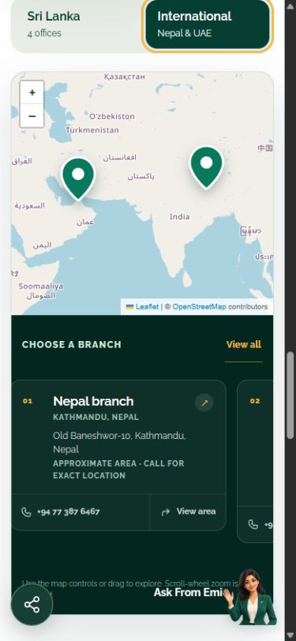

# Website performance and spam protection — implementation report

19 October 2026 · D:\EIMTS-Website

## What is finished

| Area                   | What changed                                                                           | What it means for visitors                                                  |
| ---------------------- | -------------------------------------------------------------------------------------- | --------------------------------------------------------------------------- |
| Job caching            | Shared public job cache, dashboard invalidation, 60-second fallback                    | Popular pages reuse job data instead of asking the database on every visit. |
| Job search             | Database filters, accurate totals and facet counts, cursor pagination                  | Only 6 or 12 jobs are sent per page, even when the catalogue grows.         |
| Spam protection        | Cloudflare Turnstile on contact, employer and application forms, checked on the server | Requests must pass verification before submission processing begins.        |
| Submission limits      | Shared database counters                                                               | A visitor cannot bypass the limits by reaching a different server instance. |
| Inquiry delivery       | Durable queue, duplicate submission IDs, limited workers and retries                   | Contact/employer inquiries survive temporary SMTP problems.                 |
| Candidate applications | Direct email, no CV storage, bounded upload size                                       | Applications continue to go straight to cv@emeraldisle.lk.                  |
| Typography             | Raleway only, local regular/italic variable WOFF2 files                                | No Google Fonts stylesheet request. Only the regular file is preloaded.     |
| Contact map            | Branch content renders immediately; Leaflet loads near the map                         | Less JavaScript and map work during initial contact-page loading.           |

The website changes are implemented locally. The three database migrations have
also been applied to the connected **Eimts2026's New Web Site Database** project.
The website/dashboard have not been deployed by this task. Keys and the scheduler
still need the setup below. Protected forms intentionally reject submissions when
their required configuration is missing.

## 1. How job caching works

The simple choice is Next.js's existing data cache. No Redis account is required.
Job listings, catalogue search responses and job details use a shared public-data
tag. Creating, editing, changing the status of, or deleting a job in the dashboard
sends an authenticated invalidation request to the website. The next website
request then loads fresh job data. People with an already open page still need to
refresh or navigate to see changes; this is not a live push notification system.

The fallback revalidation interval is **60 seconds**. If dashboard invalidation
fails, a later request starts background refresh after that interval. That first
request may receive the previous result. During database outages, older cached
data can remain available, so this is not a strict promise that every result is
less than 60 seconds old. Applications independently check current job status and
expiry before emailing a CV.

The cache contains anonymous public vacancy data only. Candidate and inquiry
details are never put in it. Homepage occasion content and promotional popups
retain their existing fresh-read behavior.

Job detail metadata and page rendering now share a request-scoped React cache as
well as the public data cache. This makes reuse explicit around the Supabase
loader rather than relying on implicit fetch matching.

### Cache setup

1. Generate a long random secret locally. For example, run:

   ```powershell
   node -e "console.log(require('crypto').randomBytes(32).toString('hex'))"
   ```

2. In the **website** Vercel project, add `PUBLIC_CACHE_REVALIDATION_SECRET`.
3. In the **dashboard** Vercel project, add the same value and set
   `PUBLIC_WEBSITE_ORIGIN=https://emeraldislemanpower.com`.
4. Redeploy both projects. Include Preview variables separately if preview
   environments should communicate; do not point a test dashboard at production.

Optional: set `PERFORMANCE_LOGS=1` in the website project. Logs then include
`public_cache_read` with the cache age, alongside `public_cache_fill` with load
duration. Aggregate reads and fills to see whether reuse improves. Invalidation
logs show success, missing configuration or failure. This is log-based monitoring;
no paid monitoring service or alert dashboard was provisioned.

## 2. How vacancy search works

Keyword, location, category and sorting now run in the database. The page renders
the requested result directly from its URL. Dropdowns include matching counts.
The count for each dropdown keeps the other selected filters active, allowing
visitors to see alternative choices rather than losing all other options.

There are two page sizes: **6 and 12**. Next/Previous use a cursor rather than
downloading every job and slicing the list in the browser. Ordering has a unique
ID tie-breaker for each supported sort. A direct link into a later cursor page
offers a First page action when there is no local previous-page history.
Edits to sorting fields while someone browses can still move jobs between pages;
the catalogue is live rather than a frozen snapshot.

The database function uses the caller's existing row-level security. Draft and
expired jobs are excluded explicitly. It exposes only the public listing fields.
Invalid page sizes, including explicit null values sent directly to the RPC, are
rejected. The UI distinguishes a load error from an empty catalogue.

The live database contained only three visible jobs. Its existing listing query
completed in approximately 0.22 ms in the database check, but that tiny dataset
does not justify a new job index or establish large-catalogue performance. No
speculative job indexes were added. Exact facet counts still require database
aggregation; profile this against representative growth before adding search or
sort indexes.

## 3. Bot protection setup — required before accepting forms

1. Open the [Cloudflare Turnstile dashboard](https://dash.cloudflare.com/?to=/:account/turnstile).
2. Choose **Add widget**. Name it “Emerald Isle website”. Select **Managed** mode.
3. Add the production hostname(s), including `emeraldislemanpower.com` and
   `www.emeraldislemanpower.com` as appropriate. Use a separate development widget
   for local/preview testing and add its exact hosts.
4. Copy the **site key** and **secret key**.
5. In the **website** Vercel project's Environment Variables, add:

   | Variable                         | Value                                                 |
   | -------------------------------- | ----------------------------------------------------- |
   | `NEXT_PUBLIC_TURNSTILE_SITE_KEY` | Cloudflare site key; this is public                   |
   | `TURNSTILE_SECRET_KEY`           | Cloudflare secret; server only                        |
   | `TURNSTILE_ALLOWED_HOSTNAMES`    | `emeraldislemanpower.com,www.emeraldislemanpower.com` |
   | `SUPABASE_SECRET_KEY`            | Supabase server secret for the connected project      |

   A legacy `SUPABASE_SERVICE_ROLE_KEY` is also supported instead of
   `SUPABASE_SECRET_KEY`. Keep it server-only; never use a `NEXT_PUBLIC_` prefix.
   The Supabase key enables the protected rate-limit and inquiry-queue operations.

6. Redeploy the website. The site key is included at build time, so changing it
   requires a new build. For local development, add matching values to `.env.local`
   and restart the dev server. Production host allowlists should contain only your
   production hosts; development automatically permits localhost/127.0.0.1.
7. After deployment, check all three forms. A valid submission must pass Turnstile;
   an expired/missing token must be rejected. Confirm actual inbox delivery as
   described in the next section. Do not put Cloudflare test keys in production.

The server calls Cloudflare Siteverify and checks both the hostname and the form
action. Tokens are not accepted solely because the widget displays success.
Verification has an eight-second timeout and fails closed during an outage.
Narrow form containers use Turnstile's compact widget to avoid mobile overflow.
Tokens expire and are single-use, so the form refreshes verification after a
submission attempt. Details follow Cloudflare's [widget setup](https://developers.cloudflare.com/turnstile/get-started/widget-management/dashboard/)
and [server validation](https://developers.cloudflare.com/turnstile/get-started/server-side-validation/).

### Shared submission limits

- Three attempts per normalized email address per ten minutes, separately for
  applications and inquiries.
- On Vercel, an additional fifteen attempts per platform-forwarded IP per ten
  minutes. Local/non-Vercel deployment retains the email limit; review trusted
  proxy headers before enabling an IP rule on another host.
- Addresses and IPs are stored as secret-keyed hashes in the counter table, not
  plain text. Expired counters are cleaned by the delivery worker.

These limits help control email abuse. Turnstile and application limits do not
replace edge protection against a high-volume denial-of-service attack. Add a
Vercel Firewall rule for public search/form endpoints if traffic requires it.

## 4. Email delivery and scheduler setup

### Contact and employer inquiries

Inquiries are saved before the success response. The form says **received**, not
delivered. Repeating a submission ID with the same content does not create another
queue entry. Queue data is accessible only to server credentials.

Workers claim up to three entries with database leases and locking; no more than
three unexpired claims are allowed across worker instances. A worker sends its
entries serially, with connection/socket timeouts. Failures get increasing delays
and up to five attempts. Exhausted entries go to a `dead` state for review.
Partial recipient acceptance goes to review instead of resending automatically
to inboxes that already accepted the message.

Confirmed delivery clears the inquiry payload immediately. Sent/dead receipts
are removed after seven days by the worker. Pending inquiries retain their
contents for delivery. SMTP cannot guarantee exactly-once delivery after an
ambiguous connection failure; stable message IDs and idempotent queue insertion
reduce duplication but do not remove that protocol limitation.

To run delivery:

1. Keep the existing `SMTP_HOST`, `SMTP_PORT`, `SMTP_USER`, `SMTP_PASSWORD` and
   optional `APPLICATIONS_EMAIL_FROM` configured in the website project.
2. Generate another random secret and add it as **`CRON_SECRET`**.
3. Schedule an authenticated GET request to
   `https://emeraldislemanpower.com/api/cron/inquiries/` once per minute, with
   `Authorization: Bearer YOUR_CRON_SECRET`.
4. On a Vercel plan that supports minute-level Cron Jobs, merge the `crons` field
   from `docs/vercel-cron.example.json` into the website's root `vercel.json`, then
   deploy. Vercel attaches `CRON_SECRET` to its requests. Otherwise use a trusted
   external scheduler with the same authorization header. Configure the scheduler
   before enabling public forms; setting a secret alone does not run the queue.

The cron example is deliberately not installed as an active schedule because the
account plan was not verified. Check current [Vercel Cron plan limits](https://vercel.com/docs/cron-jobs/usage-and-pricing).
The initial delivery budget is modest: at most three messages per invocation.
Increase it only after measuring queue age and confirming SMTP provider quotas.

Existing recipients are `info@emeraldisle.lk` for Contact and `admin@emerldisle.lk`
for Employer. The second employer address uses the
existing **emerldisle** spelling; confirm this address before the inbox test.

In Supabase SQL Editor, inspect queue health without displaying message contents:

```sql
select status, count(*) as messages, min(created_at) as oldest
from public.website_inquiry_outbox
group by status;
```

Investigate any `dead` entries and growing oldest-pending age. Their `last_error`
is a generic delivery code; logs do not contain inquiry content. After resolving
the cause, an administrator can explicitly requeue a failed inquiry. Check for
partial/uncertain acceptance first to avoid unnecessary duplicates.

### Candidate applications — your no-storage choice

CVs remain in request memory and go directly to `cv@emeraldisle.lk`. They are not
saved to the queue, Supabase Storage or an applications table by this route.
Applications are not retried by a background worker. Success still means the SMTP
server accepted the message for the recruitment inbox.

The website upload limit is now **3 MB**, with a **4 MB** complete-request bound.
Larger CVs are directed to the recruitment email address. This fits below
[Vercel's 4.5 MB request limit](https://vercel.com/docs/functions/limitations), which
applies before application code can raise its own limit. A reliable 10 MB browser
upload would require a different transport or temporary storage.

## 5. Fonts and contact maps

The website uses locally hosted Raleway variable fonts in normal and italic
styles. The normal file is 48,264 bytes; italic is 50,244 bytes. Only normal is
preloaded. Arial fallback metrics are adjusted to Raleway to reduce text movement
while the font loads. This is a preventative font-metric adjustment, not a measured
claim of a new CLS score. The font licence and source stylesheet are saved beside
the files under `public/fonts/raleway/`.

Contact map headings, tabs, office cards and directions links render immediately.
The Leaflet code and interactive map load within 300 px of the canvas, from a
direct branch-map hash, or from the Load/View all controls. The existing canvas
dimensions are reserved. Sri Lanka and International tabs keep their keyboard
controls and map loading does not hide branch contact details.



## Checks completed

| Check                                                     | Result                                                                                                  |
| --------------------------------------------------------- | ------------------------------------------------------------------------------------------------------- |
| Production website build, webpack                         | Passed compilation, TypeScript and all 28 prerendered pages                                             |
| Dashboard TypeScript                                      | Passed                                                                                                  |
| Search parameter validation and server verification cases | Passed `node scripts/verify-submission-protection.mjs`                                                  |
| Missing verification config                               | Form endpoints rejected submissions; no mail sent                                                       |
| Temporary database pagination fixture                     | 23 visible jobs, four pages, three sorts, no duplicate or omitted IDs                                   |
| Direct RPC null page size                                 | Rejected                                                                                                |
| Anonymous access to private submission tables/worker RPC  | Denied                                                                                                  |
| Shared email rate counter                                 | Fourth attempt blocked after three allowed attempts                                                     |
| Queue claim budget                                        | Further claims returned zero while three leases were active                                             |
| Production cache                                          | Two identical reads produced one fill; authorized invalidation forced a new fill; wrong secret rejected |
| Mobile vacancy search                                     | “nursing” returned one result; URL updated; no horizontal overflow at 390 px                            |
| Contact map                                               | Deferred at page top; direct international link loaded the map; keyboard switching passed               |
| Raleway                                                   | Loaded locally; one normal-font preload; no Google Fonts stylesheet request                             |
| Whitespace/diff check                                     | Passed                                                                                                  |

Database fixtures were temporary or rolled back. No real applicant CV or inquiry
was submitted during verification. Actual Turnstile tokens, SMTP delivery and the
live scheduler remain unverified until credentials and deployment are configured.
No million-user load test or before/after Lighthouse benchmark was performed.

The database advisor reports the new server-only tables have RLS and no public
policies; this is intentional deny-by-default access. Existing staff helper and
password-protection warnings were not changed. See the advisor's
[RLS policy explanation](https://supabase.com/docs/guides/database/database-linter?lint=0008_rls_enabled_no_policy).
Unused-index notices include the newly created expiry-cleanup index; it has not
yet had production cleanup traffic. Existing foreign-key indexes were retained.

## What to do next

1. Configure the website variables, dashboard cache variables and the scheduler.
2. Deploy the website and dashboard together.
3. Check a dashboard job change appears after a website refresh.
4. Submit a real inquiry and application yourself and confirm the intended inboxes.
5. Watch cache fills, queue age, errors and SMTP quotas. Before larger traffic,
   run a representative catalogue/load test and set capacity from measured
   requests per second, rather than a monthly user count.
